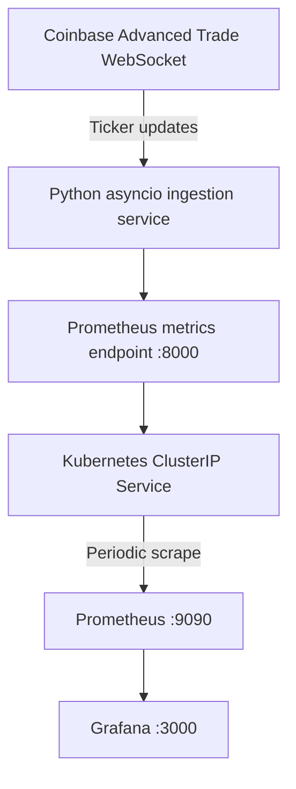

# Real-Time-Market-Data-Observability-Pipeline-Infra

An asynchronous market-data ingestion service that consumes live BTC-USD ticker updates from Coinbase Advanced Trade and exposes operational metrics through Prometheus. The repository includes Docker and Kubernetes configuration, Prometheus scraping, and a provisioned Grafana dashboard.

## Architecture



## Key Features

- Asynchronous WebSocket ingestion for the Coinbase BTC-USD ticker channel.
- Automatic reconnect attempts with exponential backoff.
- Structured application logging and WebSocket keepalive settings.
- Prometheus instrumentation for message volume, message age, and connection failures.
- Docker image definition using a slim Python base image and a non-root application user.
- Kubernetes Deployment with resource requests, limits, and HTTP health probes.
- Internal ClusterIP Services for metrics, Prometheus, and Grafana.
- Prometheus scraping configuration and a Grafana dashboard provisioned from files.

## Technology Stack

| Component | Technology |
|---|---|
| Language | Python |
| Asynchronous I/O | asyncio, websockets |
| Metrics | prometheus-client |
| Containerization | Docker |
| Orchestration | Kubernetes |
| Monitoring | Prometheus |
| Dashboards | Grafana |

## Metrics

| Metric | Type | Meaning |
|---|---|---|
| `coinbase_messages_received_total` | Counter | Number of inbound WebSocket messages received. |
| `coinbase_message_latency_seconds` | Gauge | Estimated message age: local UTC time minus Coinbase's message timestamp. |
| `coinbase_websocket_reconnects_total` | Counter | Connection failures that trigger a reconnect attempt. |

**Timing note:** The timestamp-derived gauge is an estimate of message age, not a pure one-way network latency measurement. It can include exchange/feed processing delays and local clock differences.

## Repository Structure

```text
.
├── src/
│   └── main.py
├── k8s/
│   ├── deployment.yaml
│   ├── service.yaml
│   ├── prometheus-config.yaml
│   ├── prometheus.yaml
│   ├── market-data-dashboard.json
│   ├── grafana.yaml
│   └── kustomization.yaml
├── Dockerfile
├── .dockerignore
├── .gitignore
├── requirements.txt
└── README.md
```

## Run Locally on Windows

Requires Python 3.13 and an internet connection.

From the repository root, run:

```powershell
py -3.13 -m venv .venv
.\.venv\Scripts\python.exe -m pip install -r requirements.txt
.\.venv\Scripts\python.exe src/main.py
```

While the application is running, visit:

**http://localhost:8000/metrics**

Check for the three metric names listed above. The message counter should increase as WebSocket messages arrive. The reconnect counter may remain zero while the connection is healthy.

Stop the application with `Ctrl+C` in the terminal running it.

## Build and Run with Docker

Requires a working Docker Engine.

Build the image from the repository root:

```bash
docker build -t real-time-market-data:latest .
```

Run it:

```bash
docker run --rm -p 8000:8000 real-time-market-data:latest
```

Open `http://localhost:8000/metrics` to inspect the exposed metrics.

## Deploy to a Local Kubernetes Cluster

Requires Docker and Minikube, or another working local Kubernetes environment.

For Minikube:

```bash
minikube start
minikube image build -t real-time-market-data:latest .
kubectl apply -k k8s/
kubectl get pods
kubectl rollout status deployment/market-data-ingestion
```

Check the ingestion service logs:

```bash
kubectl logs deployment/market-data-ingestion
```

To inspect the metrics endpoint, open a separate terminal and run:

```bash
kubectl port-forward service/market-data-metrics 8000:8000
```

Then visit `http://localhost:8000/metrics`.

## Prometheus and Grafana

Forward the Prometheus Service in one terminal:

```bash
kubectl port-forward service/prometheus 9090:9090
```

Open **http://localhost:9090/targets** and check that the `market-data-ingestion` target is `UP`.

Forward Grafana in another terminal:

```bash
kubectl port-forward service/grafana 3000:3000
```

Open **http://localhost:3000**. The dashboard and Prometheus data source are provisioned from the repository configuration. On a fresh local Grafana installation, the default initial login is commonly `admin` / `admin`; change the password if prompted.

## Reliability and Design Decisions

- **asyncio:** supports concurrent network I/O without dedicating an operating-system thread to every outstanding operation.
- **Prometheus pull model:** Prometheus periodically scrapes the application's HTTP metrics endpoint.
- **Exponential backoff:** reconnect delays increase after consecutive connection failures, up to a configured cap.
- **ClusterIP Services:** expose the metrics and monitoring applications inside the Kubernetes cluster without publishing them directly to the public internet.
- **Health probes:** check the HTTP metrics endpoint. They verify that the endpoint responds; they do not independently prove that the Coinbase feed is connected.

## Validation Status

The Python service has been run locally against Coinbase. The metrics endpoint and the three metrics were inspected, and reconnection behavior was exercised locally.

Docker image builds and the Kubernetes/Prometheus/Grafana deployment still need to be executed on a machine with a working Docker and Kubernetes environment before those deployment stages can be described as verified.

## Scope

This project focuses on real-time data ingestion, operational metrics, and deployment infrastructure. It does not execute trades or make investment recommendations.
